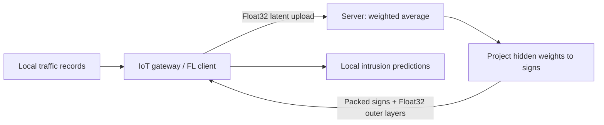

# GF-IDS

### Federated intrusion detection with hybrid binary neural networks

**96 completed runs · 2 IoT datasets · 3 seeds per condition · encoded model messages**

GF-IDS studies the detection–communication trade-off of binary hidden layers
in a five-client federated intrusion detector. Input and output layers stay
in Float32. The server averages real-valued client weights, projects hidden
weights to signs and broadcasts a packed model. Uploads remain Float32.

This repository contains research code and archived experiment records.
Manuscript sources are maintained separately. The experiments simulate a
federation; they do not measure a deployed network or gateway energy.

[Results](#results) · [Protocol](documentation/PROTOCOL.md) ·
[Reproduce](documentation/REPRODUCIBILITY.md) · [Data](documentation/DATA.md) ·
[Limitations](#scope-and-limitations)



## Results

Validation-selected holdout scores, **mean over seeds 42, 43 and 44**.
Downlink is the encoded tensor payload per client and round after the initial
Float32 broadcast. KiB = 1,024 bytes.

| Model | CICIoT2023 accuracy | Macro F1 | NF-ToN-IoT-v2 accuracy | Macro F1 | CIC downlink (KiB) |
|---|---:|---:|---:|---:|---:|
| **GF-IDS** | **97.60%** | **0.610** | **91.72%** | **0.641** | **23.51** |
| FP32-Twin | 98.68% | 0.688 | 92.88% | 0.795 | 62.26 |
| MLP-FL | 98.07% | 0.648 | 92.78% | 0.799 | 63.76 |
| MLP-INT8 | 88.76% | 0.551 | 92.73% | 0.799 | 18.96 |
| BNN-INT8IO | 86.26% | 0.544 | 89.94% | 0.612 | 8.70 |
| BNN-Full | 71.56% | 0.361 | 73.09% | 0.434 | 4.38 |
| CNN-FL | 85.70% | 0.592 | 93.02% | 0.823 | 333.38 |
| LSTM-FL | 94.67% | 0.600 | 87.88% | 0.618 | 209.51 |

**What the comparison shows:** GF-IDS broadcasts 62–65% less than its
identical-layout Float32 twin, with about one accuracy point lost. Macro F1
shows a larger penalty, particularly on NF-ToN-IoT-v2. On that dataset the
INT8 MLP has better detection scores and a smaller payload than GF-IDS.

Standard deviations, benign false-alarm rates, attack miss rates, non-overlap
scores and per-seed values are in the machine-readable summaries:

- [CICIoT2023 summary](runs_v2/cic/summary.json)
- [NF-ToN-IoT-v2 summary](runs_v2/nfton/summary.json)

Bold identifies the proposed system; it does not mean the best score.

## Start here

Inspect the saved evidence with **Python only**, without downloading datasets
or installing a training environment:

```bash
python code/check_run_records.py
```

The check validates completion, validation-based checkpoint selection and
aggregate scores against the per-run files. It does not rerun inference.

To reproduce a training run, first install dependencies and prepare the
matching data files as described in [the reproduction guide](documentation/REPRODUCIBILITY.md):

```bash
python -m pip install -r requirements.txt
python code/fl_v2.py --dataset cic --model BNN-MATCHED --seed 42
```

For custom raw-data roots, set `GFIDS_CIC_RAW` or `GFIDS_NFTON_RAW`.
The [data guide](documentation/DATA.md) explains the required layout and the
limits of the split provenance. Raw datasets and model checkpoints are not
included.

## Model names

| Manuscript name | CLI `--model` |
|---|---|
| GF-IDS | `BNN-MATCHED` |
| FP32-Twin | `MLP-TWIN` |
| MLP-FL | `MLP` |
| MLP-INT8 | `MLP-INT8` |
| BNN-INT8IO | `BNN-INT8IO-MATCHED` |
| BNN-Full | `BNN-FULL-MATCHED` |
| CNN-FL | `CNN` |
| LSTM-FL | `LSTM` |

## Repository map

| Path | Purpose |
|---|---|
| [`code/fl_v2.py`](code/fl_v2.py) | Training, validation selection and restart state |
| [`code/codec.py`](code/codec.py) | Binary/INT8 downlink encoding and Float32 uploads |
| [`code/eval_v2.py`](code/eval_v2.py) | Best/final checkpoint scoring and summaries |
| [`code/metrics_v2.py`](code/metrics_v2.py) | Multiclass and operational security metrics |
| [`code/check_run_records.py`](code/check_run_records.py) | Dataset-free evidence consistency check |
| [`runs_v2/`](runs_v2/) | Main immutable configurations, histories and scores |
| [`data_v2/`](data_v2/) | Frozen feature transforms and class orders |
| [`documentation/`](documentation/) | Protocol, data and reproduction guides |
| `run_v2_*.ps1` | Experiment queues; read each script's scope before running |
| `runs/`, `runs_nfton/`, `runs_unsw/` | Earlier exploratory outputs; separate from the main matrix |

## Scope and limitations

- **Simulated federation:** five synchronous clients, with full participation.
- **Row-level splits:** exact processed-row overlap is reported; results do
  not establish unseen-device, site or time generalization.
- **Detection cost:** rare-class performance and severe label skew remain
  weaknesses. Accuracy alone is insufficient to judge an IDS.
- **Uncompressed upload:** Float32 latent weights dominate much of a round trip.
- **Shared settings:** no equal-budget per-model hyperparameter search was run.
- **Arithmetic energy proxy:** float emulation is used; there is no packed
  inference kernel or measured gateway speed/energy. Binary-term and integer
  costs depend on explicit modelling assumptions.
- **Adapted external baselines:** exploratory sign-vote and score-based
  comparisons do not reproduce the published systems.

The first exploratory runs selected checkpoints using the development test
set. Protocol v2 separates validation selection from holdout evaluation;
see [the protocol](documentation/PROTOCOL.md) before reusing any result.

## Questions and reuse

Use this repository's issue tracker for code and reproducibility questions.
The code is released under the [MIT License](LICENSE). Dataset reuse follows
the original providers' terms; the datasets are not redistributed here. To cite
the repository, use the "Cite this repository" button or
[`CITATION.cff`](CITATION.cff).
